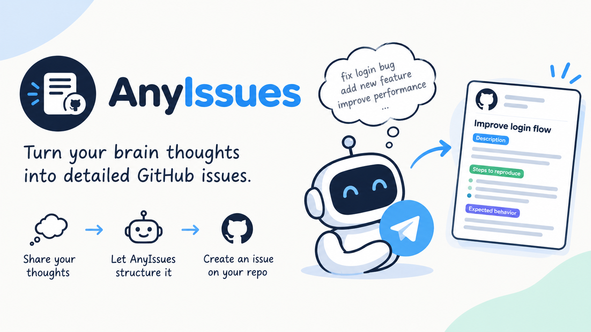

<p align="center">
  
</p>

# AnyIssues

A personal Telegram bot that turns a raw, half-formed thought into a
well-structured GitHub issue in the right repo, and sends you a daily
"what's outstanding?" summary at a time you choose.

You message the bot something like *"login page flashes white on dark mode,
also the remember-me checkbox does nothing"*. Claude shapes it into a titled
ticket with acceptance criteria. You tap buttons to pick **project / type /
urgency**, hit **Confirm**, and it's filed as a labelled issue in that repo,
ready for you or a coding agent to pick up.

- **Capture in seconds.** Send a text from your phone. Nothing is filed until
  you confirm.
- **Every repo is a project.** The project buttons are your own repos (not
  forks, not archived), fetched live from GitHub. There's nothing to register.
- **Eureka ideas** for apps that don't exist yet go to a single `braindump`
  repo.
- **Daily digest** of every open issue across your repos, summarised by Claude
  and delivered at the time and timezone you set. Send `/digest` any time for
  one on demand.
- **Yours, and nearly free.** It runs in your own AWS account on pay-per-use
  services (Lambda, SQS, DynamoDB, EventBridge Scheduler), set up with one
  `terraform apply`.

How it's built, and why, is in **[docs/ARCHITECTURE.md](docs/ARCHITECTURE.md)**.

## How it works

```
You ──Telegram──▶ webhook_handler ──queue──▶ shape_worker ──▶ Claude (shape the ticket)
 ▲                      │                         │
 │                      │                         └──▶ preview + buttons back to you
 │                      └── button taps, Confirm ──▶ GitHub issue created, link sent back
 │
 └── digest ◀── daily schedule (your time) or /digest ──▶ open issues ──▶ Claude summary
```

Three small Python Lambdas, one DynamoDB table for in-progress drafts, and an
SQS queue so slow Claude calls never time out Telegram. No servers to run.

## Set up your own

A first setup takes about **20 minutes**. You'll end up with your own private
bot that only answers you and files issues into **your** repos.

### Before you start

**Accounts:**
- An **AWS account**. Everything runs there; at one person's volume it sits at
  or near the free tier.
- A **GitHub account** with the repos you want issues filed into.
- A **Telegram account**.
- A **Claude API account** ([platform.claude.com](https://platform.claude.com)).
  This is the main running cost: one Claude call per captured thought, plus
  one per digest.

**Tools on your machine:**
[AWS CLI](https://docs.aws.amazon.com/cli/latest/userguide/getting-started-install.html)
(logged in to your account), [Terraform](https://developer.hashicorp.com/terraform/install)
1.5 or newer, the [GitHub CLI](https://cli.github.com/) (`gh`), and Python 3
(Terraform uses it to package the Lambdas).

**What you'll collect along the way:**

| Value | Where it comes from | Where it goes |
|---|---|---|
| GitHub username | your profile | `terraform.tfvars` |
| GitHub token (PAT) | step 2 | `terraform.tfvars` and SSM |
| Telegram bot token | step 3, @BotFather | SSM |
| Your Telegram user ID | step 3, @userinfobot | `terraform.tfvars` |
| Claude API key | step 4, Claude Console | SSM |

"SSM" is AWS Systems Manager Parameter Store, an encrypted key-value store in
your AWS account. The Lambdas read their credentials from it when they run, so
none of them is ever stored in Terraform's files.

### 1. Get the code and pick a region

```bash
gh repo fork anyhowwws/AnyIssues --clone
```

A fork of a public repo is public. That's fine, because nothing secret is ever
committed. If you'd rather keep your copy private, clone this repo and push it
to a new private repo of your own instead.

Every AWS command below runs in one region. The default is `ap-southeast-1`
(Singapore). To use another, set it now, and set `aws_region` to the same value
in step 5:

```bash
export AWS_REGION=ap-southeast-1
```

### 2. GitHub: a braindump repo and a token

Create the repo that "eureka" ideas (new apps with no repo yet) are filed into:

```bash
gh repo create braindump --private
```

Then create a fine-grained personal access token at
[github.com/settings/personal-access-tokens/new](https://github.com/settings/personal-access-tokens/new):

- **Repository access:** All repositories (or every repo you want offered,
  plus braindump)
- **Permissions:** Issues → Read and write. Metadata → Read-only is added
  automatically.

Copy the token (`github_pat_…`). Every repo you own that isn't a fork or
archived becomes a project button, newest-updated first.

### 3. Telegram: create your bot

1. Message [@BotFather](https://t.me/BotFather), send `/newbot`, follow the
   prompts, and copy the **bot token** it gives you.
2. Message [@userinfobot](https://t.me/userinfobot) and copy your numeric
   **user ID**. The bot ignores everyone except this ID.

### 4. Claude: an API key

In the [Claude Console](https://platform.claude.com/settings/keys), create an
API key (`sk-ant-…`). Later, once everything works, you can optionally switch
to [keyless auth](#optional-keyless-claude-auth-workload-identity-federation).

### 5. Store the secrets and configure

Put the three credentials into SSM. Paste each value in place of the
placeholder:

```bash
aws ssm put-parameter --name /anyissues/telegram-bot-token --type SecureString --value "<bot token from step 3>"
```

```bash
aws ssm put-parameter --name /anyissues/github-pat --type SecureString --value "<github_pat_… from step 2>"
```

```bash
aws ssm put-parameter --name /anyissues/anthropic-api-key --type SecureString --value "<sk-ant-… from step 4>"
```

Now create your settings file:

```bash
cd terraform && cp terraform.tfvars.example terraform.tfvars
```

Open `terraform/terraform.tfvars` and fill in the **Required** section:
`github_owner`, `github_pat` (the same token again), and
`allowed_telegram_user_id`. The file is gitignored, so it stays on your machine.

### 6. Choose when your digest arrives

In the same `terraform.tfvars`, set `digest_schedule` and `digest_timezone`.
The default is every day at 18:00 Singapore time. Some examples:

| You want | `digest_schedule` |
|---|---|
| Every day at 18:00 | `cron(0 18 * * ? *)` |
| Weekdays at 08:30 | `cron(30 8 ? * MON-FRI *)` |
| Mondays at 09:00 | `cron(0 9 ? * MON *)` |

`digest_timezone` takes an [IANA name](https://en.wikipedia.org/wiki/List_of_tz_database_time_zones)
such as `Europe/London` or `America/New_York`. You can change either at any
time; it takes effect on the next `terraform apply`.

### 7. Deploy

From the `terraform/` folder:

```bash
terraform init
```

```bash
terraform apply
```

Review the plan and type `yes`. Besides the AWS resources, this creates the
`bug`, `feature`, `eureka` and `urgency:*` labels in each of your repos.

Terraform keeps track of what it created in `terraform/terraform.tfstate`.
Don't delete that file. It's gitignored and holds no API credentials, but keep
it private. (For S3-backed state and automatic deploys, see
[Continuous deployment](#optional-continuous-deployment).)

### 8. Connect Telegram to your bot

Tell Telegram where to send your messages. These commands read the bot token
back from SSM and the webhook address from Terraform, so there's nothing to
copy by hand. Run them from the `terraform/` folder:

```bash
BOT_TOKEN=$(aws ssm get-parameter --name /anyissues/telegram-bot-token --with-decryption --query Parameter.Value --output text)
```

```bash
curl -sS "https://api.telegram.org/bot$BOT_TOKEN/setWebhook" -d "url=$(terraform output -raw webhook_url)" -d "secret_token=$(terraform output -raw webhook_secret)"
```

You should see `"ok":true`.

### 9. Try it

Send your bot a raw thought. It replies "thinking...", then turns that message
into a title and acceptance criteria with project / type / urgency buttons.
Tap through and hit **Confirm** to get the issue link. **Edit** makes your next
message a correction to the same draft; **Discard** drops it.

Send `/digest` to get your outstanding-work summary right away. The scheduled
one arrives at the time you set in step 6.

**Created a new repo later?** Run `terraform apply` again so it gets the
labels. Filing into a repo without them fails.

## Make it yours

These settings go in `terraform.tfvars` and take effect on the next
`terraform apply`:

| Setting | Default | What it does |
|---|---|---|
| `digest_schedule` | `cron(0 18 * * ? *)` | when the digest arrives ([cron format](https://docs.aws.amazon.com/scheduler/latest/UserGuide/schedule-types.html#cron-based)) |
| `digest_timezone` | `Asia/Singapore` | the timezone that schedule runs in |
| `digest_enabled` | `true` | `false` pauses the schedule; `/digest` still works |
| `braindump_repo` | `braindump` | where eureka ideas go |
| `anthropic_model` | `claude-sonnet-5` | the Claude model that writes tickets and digests |
| `draft_ttl_hours` | `24` | unconfirmed drafts are deleted after this |
| `aws_region` | `ap-southeast-1` | where everything is deployed |
| `project_name` | `anyissues` | prefix for every AWS resource and SSM path (change the `/anyissues/` SSM paths to match) |

Things that live in code:

- **Ticket style:** `SYSTEM_PROMPT` in `lambdas/shape_worker/handler.py`
- **Digest style:** `SYSTEM_PROMPT` in `lambdas/digest/handler.py`
- **Label names and colours:** `terraform/github_labels.tf` (the button values
  in the handlers must match)

## Troubleshooting

All three Lambdas log to CloudWatch. To see the last half hour of one (swap in
`shape-worker` or `digest`):

```bash
aws logs tail /aws/lambda/anyissues-webhook-handler --since 30m
```

| Symptom | Likely cause and fix |
|---|---|
| The bot never replies | Check the webhook with `curl "https://api.telegram.org/bot$BOT_TOKEN/getWebhookInfo"`: `last_error_message` says what's wrong. Also check `allowed_telegram_user_id` is *your* ID; the bot silently ignores everyone else. |
| The bot says "thinking..." and stops | Look at the `shape-worker` logs. A bad Claude key or GitHub token shows up there as a 401. |
| `ParameterNotFound` in the logs | An SSM parameter is missing, or was created in a different region from the Lambdas. Re-run the step 5 command with the right `AWS_REGION`. |
| Confirm fails on a new repo | The repo has no labels yet. Run `terraform apply`. |
| `terraform plan` fails with a GitHub 401 | The `github_pat` in `terraform.tfvars` is wrong or expired. Terraform uses it to find your repos. |
| Logs say `WIF exchange failed ... 401` | Only with keyless auth: see [checking keyless auth](#check-that-its-working). The bot keeps working on your API key meanwhile. |

To rotate a credential, re-run its `put-parameter` command with `--overwrite`.
No redeploy is needed; the Lambdas pick it up on their next failed call.

## Optional: keyless Claude auth (Workload Identity Federation)

By default the Lambdas call Claude with the API key in SSM. Workload Identity
Federation (WIF) removes the long-lived key from the normal path: each Lambda
asks AWS for a short-lived signed token proving which IAM role it runs as, and
Anthropic swaps that for a short-lived Claude token. The API key stays in SSM
as a fallback.

Do this after the bot works, from the `terraform/` folder.

**1. Let your AWS account issue identity tokens.** This is a one-time,
account-wide switch:

```bash
aws iam enable-outbound-web-identity-federation
```

Then note your account's token issuer URL (`https://<id>.tokens.sts.global.api.aws`):

```bash
aws iam get-outbound-web-identity-federation-info --query IssuerIdentifier --output text
```

**2. Get the rule's match expression from Terraform:**

```bash
terraform output -raw anthropic_wif_cel_expression
```

It names the two IAM roles that call Claude (`shape-worker` and `digest`).

**3. Set it up in the Claude Console.** Go to **Settings → Workload identity →
Connect workload → AWS** and follow the wizard:

- **Issuer:** the issuer URL from step 1, with discovery mode.
- **Service account:** create one, for example `anyissues`.
- **Rule → Match configuration:** choose **CEL expression** and paste the
  output from step 2. Don't use a single subject pattern: it can only match
  one of the two roles, and the other Lambda would be refused.
- **Rule → Workspaces:** enable **exactly one** workspace. With more than one,
  every exchange is refused unless you also set `anthropic_workspace_id`.
- **Rule → OAuth scope:** `workspace:inference` is enough; the bot only calls
  the Messages API.

**4. Point the Lambdas at the rule.** Add the three IDs the Console shows to
`terraform.tfvars`, then run `terraform apply`:

```hcl
anthropic_federation_rule_id = "fdrl_..."
anthropic_organization_id    = "<organization UUID>"
anthropic_service_account_id = "svac_..."
```

### Check that it's working

The fallback means a broken WIF setup doesn't break the bot, so check it once.
Send the bot a message, run `/digest`, then:

```bash
aws logs tail /aws/lambda/anyissues-digest --since 30m --filter-pattern '"anthropic auth"'
```

Run it again with `anyissues-shape-worker` for the message you sent.
`anthropic auth: workload identity federation` means it works. `WIF exchange
failed ... 401` means Anthropic refused the token. The 401 is deliberately
vague; the reason is under **Workload identity → Authentication events** in
the Claude Console:

| Reason | Fix |
|---|---|
| `match_subject_prefix` | The rule doesn't accept this Lambda's role. Use the CEL expression from step 2. |
| `workspace_id_required` | The rule is enabled in more than one workspace. Enable one, or set `anthropic_workspace_id`. |
| issuer or `iss` mismatch | The rule's issuer URL must exactly match step 1's output. |
| no event at all | The rule ID is wrong or the rule is archived. Check `anthropic_federation_rule_id`. |

## Optional: continuous deployment

`.github/workflows/deploy.yml` always runs the tests and `terraform validate`
on pull requests and pushes. It can also deploy on every push to `main`, using
a short-lived AWS role over OIDC, so no AWS keys are stored in GitHub. The role
only trusts `main` of your repo, never pull requests. To turn it on:

1. **Make sure the AWS account has a GitHub OIDC provider.** There's one per
   account; create it if `aws iam list-open-id-connect-providers` shows none:

   ```bash
   aws iam create-open-id-connect-provider --url https://token.actions.githubusercontent.com --client-id-list sts.amazonaws.com
   ```

2. **Create the deploy role and state bucket.** Set `enable_ci_deploy = true`
   in `terraform.tfvars` (and `ci_github_repo` if your repo isn't named
   `AnyIssues`), then run `terraform apply`.
3. **Move Terraform state into S3:**

   ```bash
   cp backend.tf.example backend.tf
   ```

   ```bash
   terraform init -backend-config="bucket=$(terraform output -raw terraform_state_bucket)" -migrate-state
   ```

   Outside `ap-southeast-1`, also change `region` in `backend.tf.example` and
   `aws-region` in the workflow.

4. **Add the repo secrets and variables** under Settings → Secrets and
   variables → Actions. Anything that identifies your deployment is a
   **secret**: secrets are masked in logs, and a public repo's logs are public.

   | Name | Kind | Value |
   |---|---|---|
   | `AWS_GITHUB_ACTIONS_ROLE_ARN` | secret | `terraform output -raw github_actions_role_arn` |
   | `TF_STATE_BUCKET` | secret | `terraform output -raw terraform_state_bucket` |
   | `TF_VAR_GITHUB_PAT` | secret | your GitHub token |
   | `TF_VAR_ALLOWED_TELEGRAM_USER_ID` | secret | your Telegram user ID |
   | `TF_VAR_GITHUB_OWNER` | variable | your GitHub username |
   | `DEPLOY_ENABLED` | variable | `true` |
   | `TF_VAR_ANTHROPIC_FEDERATION_RULE_ID` | secret | keyless auth only: `fdrl_…` |
   | `TF_VAR_ANTHROPIC_ORGANIZATION_ID` | secret | keyless auth only: organization UUID |
   | `TF_VAR_ANTHROPIC_SERVICE_ACCOUNT_ID` | secret | keyless auth only: `svac_…` |
   | `TF_VAR_ANTHROPIC_WORKSPACE_ID` | secret | keyless auth only, and only if your rule spans several workspaces |

   Set all three keyless-auth IDs or none. The workflow stops on a partial set,
   which would otherwise switch keyless auth off without telling you.

The deploy job prints only the `Plan:` and `Apply complete!` lines, because
full Terraform output would list every repo you own, private ones included.
Run `terraform plan` locally when you need the detail.

## Running the tests

The suite uses Python's built-in `unittest`. Every Telegram, GitHub, Anthropic
and AWS call is mocked, so it never touches the network or your AWS account.
It needs Python 3.12 and `boto3`:

```bash
python3.12 -m venv .venv && .venv/bin/pip install boto3
```

```bash
.venv/bin/python -m unittest discover -s lambdas/tests -v
```

Infra checks that need no credentials:

```bash
cd terraform && terraform init -backend=false && terraform validate && terraform fmt -check
```

## How it behaves

- **No duplicates.** Telegram resends any message it isn't sure was received;
  each one is recorded, so a resend never creates a second draft. A double tap
  on Confirm files exactly one issue, and if GitHub fails you can tap again.
- **LLM output renders safely.** Messages use Telegram's HTML mode with
  escaping, so `_ * [ ] < > &` in Claude's output show up as typed.
- **Failures are explained.** If Claude refuses or returns something unusable,
  the draft is marked failed and the bot asks you to resend. Temporary errors
  (rate limits, outages) are retried up to 3 times.
- **The digest always arrives.** If the Claude call fails, you still get a
  plain list grouped by repo.

## Known limitations

- **Text only.** No voice notes or images.
- **Single user.** The bot answers one Telegram user, and the digest goes to
  that user.
- **The digest is read-only.** It lists your issues and asks which to start;
  the work itself happens in GitHub.

## License

[MIT](LICENSE)
